<p align="center">
  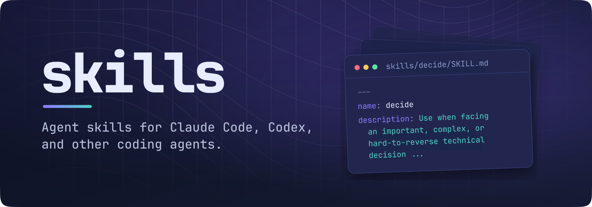
</p>

These are the personal skills I use for agentic coding. They rest on a few
principles:

- **Ground decisions in evidence.** Decide with objective criteria, research,
  and established precedent, not the model's training data or assumptions.
- **Automate as much as possible.** Hand agents the work models do best,
  especially technical decisions, research, and writing code, rather than
  prompting back and forth over every little detail.
- **Never lose work.** Sessions are ephemeral, and "remember to do it later"
  fails. Tasks, plans, and leftovers live as files in the repository, so no
  work unit gets lost.
- **Compose skills.** Skills are reusable building blocks rather than
  sealed one-job workflows. Combining them is more flexible and expressive, and
  matches how you'd naturally prompt an agent.

They cover planning work in a repository-local `.agenda/` workspace,
deciding and researching, reviewing changes, writing specs and docs, and
everyday engineering judgment. Each one is plain Markdown.

The skills are building blocks, not self-contained systems. Each one does one
job well, such as running checks, settling a decision, or committing, and you
combine several in a single prompt: `/checks /fix-lints then /git-commit`
validates, repairs, and commits in one go. Small parts that compose cover far
more ground than one large skill per workflow, and you can recombine them for
whatever the moment needs.

> [!TIP]
> The skills are generic, not tied to me, so you can use them as is, or take
> them and adapt them to your own preferences and conventions. They don't need
> to be used verbatim.

## Install

Install every skill into Claude Code and Codex, or name the ones you want. Run
it again to update them; skills you installed as links are left alone. Skills
that mention another skill work best with it installed too.

With Nix:

```sh
# Install every skill
nix run github:yuri-xyz/skills
# Install only the skills you name
nix run github:yuri-xyz/skills -- decide root-cause
```

Without Nix, run the install script:

```sh
# Install every skill
curl -fsSL https://raw.githubusercontent.com/yuri-xyz/skills/master/install.sh | bash
# Install only the skills you name
curl -fsSL https://raw.githubusercontent.com/yuri-xyz/skills/master/install.sh | bash -s -- decide root-cause
```

Or clone the repository, then run the script or link the skills, so that
`git pull` updates them:

```sh
git clone https://github.com/yuri-xyz/skills.git
cd skills
./install.sh

# Or link instead of copying
ln -s "$PWD"/skills/* ~/.claude/skills/   # Claude Code
ln -s "$PWD"/skills/* ~/.codex/skills/    # Codex
```

### Global instructions

[`global/AGENTS.md`](global/AGENTS.md) holds working agreements meant for every
repository, written to pair with these skills. Copy it, adapt it to taste, and
put it where your agent reads global instructions:

```sh
cp global/AGENTS.md ~/.claude/CLAUDE.md   # Claude Code
cp global/AGENTS.md ~/.codex/AGENTS.md    # Codex
```

## Development

The Nix flake provides the installer, a dev shell, and checks.

```sh
nix develop        # nixfmt and statix
nix fmt            # format flake.nix
nix flake check    # skill frontmatter, Nix formatting, and Nix lint
```

## Core concepts

### Agenda

The agenda is task management in plain Markdown files. It lives in an
`.agenda/` folder inside the repository and is committed with the code, so it
needs no Linear, GitHub Issues, or other tracker. Agents work with it the way
they work with everything else in the repo: they read, edit, and rename files,
and every change shows up in a normal diff.

A task is one bounded piece of work, small enough to finish in one go. A plan
covers larger work, broken into ordered items with their own checklists, locked
decisions, and a way to verify the result. Each task's filename shows whether
it is `todo`, `in_progress`, or `done`.

A task with open questions is marked not ready and lists the decisions it is
waiting on. Other tasks stay parked as ideas, wait on something outside the
repo, or need a person to act on live systems. Only settled, unblocked entries
get implemented, by hand or by `/autopilot`, and leftover work comes back as
new tasks.

<p align="center">
  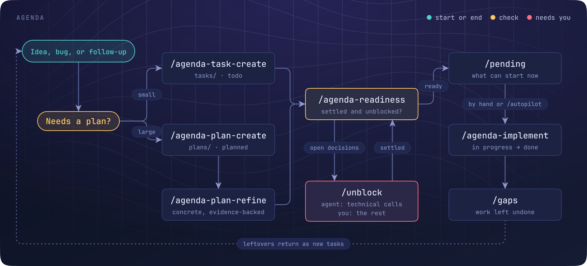
</p>

### Finishing work

At the end of longer work, the agent reports what it left undone, and each
leftover is fixed, decided, or saved as a task depending on its tag.

<p align="center">
  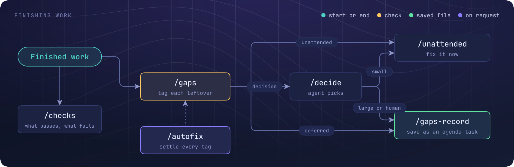
</p>

### Decisions

Decisions come in two kinds. Technical ones, such as which dependency to use,
which code pattern fits, or how to structure a module, have an answer an
engineer could defend.

Agents are good at these once they have done the research, so `/decide` lets
them settle the decision on their own instead of stopping to ask. It looks at
the code and the wider ecosystem before it judges, drops any option that
patches a symptom instead of the cause, and reports what it chose so you can
override it.

Human decisions are about direction, intent, look and feel, cost, or anything
large enough to reshape the project. They have no technical winner, so agents
leave them to you. They are not dropped, though: each one is saved as a task
with its options and a recommendation, so no pending work gets lost.

<p align="center">
  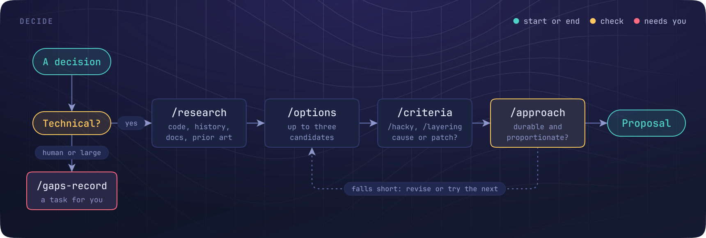
</p>

### Spec

A `.spec/` describes what the project promises. Code cites its entries, and
any change that alters a promise syncs the spec in the same session.

The spec records what the code can't: what the project does and deliberately
doesn't do, how each feature should behave, which edge cases matter, and why.
Type definitions and file tours stay in the code, which already states them.

Features, rules that must never break, API routes, domain terms, and decisions
each get their own files, with entries under stable IDs such as `§F-12` or
`§INV-03`. Rules earned by a bug, an incident, or a rejected design keep their
reason next to them, so a later agent doesn't undo a fix it can't see the
point of.

This gives agents and people one place to check intent before they change
anything. A plain search for an ID finds every line of code and every test that
depends on that promise, so it is clear what a change touches and what needs
retesting.

Because the spec is synced with the code in the same session, it stays
accurate instead of drifting like ordinary docs. The few properties that are
core and easy to get wrong can also be marked for formal verification, so a
tool checks them instead of a reviewer.

<p align="center">
  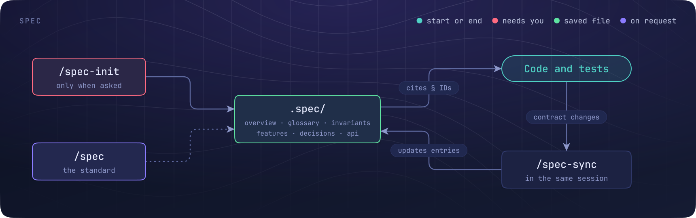
</p>

### Debugging

Logs answer one question at a time, and the fix lands where the bug starts.
Temporary probes come out once it does.

<p align="center">
  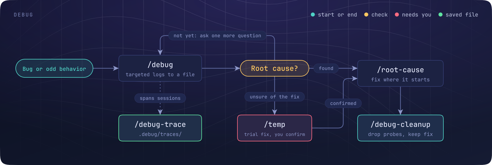
</p>

## Skills

Each skill is a directory with a `SKILL.md` whose frontmatter `name` matches the
directory and whose `description` tells the agent when to load it. Some also
carry `references/` loaded on demand, and `agents/openai.yaml` with display
metadata for Codex. The skills are self-contained: they reference only each
other, as `/skill-name`.

### Agenda workspace

Plain-Markdown tasks, plans, notes, and roadmaps under `.agenda/`.

- [`agenda`](skills/agenda/SKILL.md): Keeps your tasks, plans, notes, and roadmap as plain Markdown in the repo, readable by you and every agent.
- [`agenda-task-create`](skills/agenda-task-create/SKILL.md): Turns a bug, idea, or follow-up from the chat into a task, so it isn't forgotten when the session ends.
- [`agenda-note-create`](skills/agenda-note-create/SKILL.md): Saves findings, rationale, and references as notes, so the next session doesn't rediscover them.
- ⭐ [`agenda-plan-create`](skills/agenda-plan-create/SKILL.md): Researches a larger change and writes a step-by-step plan an agent can carry out later without guessing.
- [`agenda-plan-refine`](skills/agenda-plan-refine/SKILL.md): Checks an existing plan against the code and fills its gaps until it's ready to hand off.
- ⭐ [`agenda-roadmap`](skills/agenda-roadmap/SKILL.md): Researches your project and its field, proposes features worth building, and records the ones you pick.
- ⭐ [`agenda-implement`](skills/agenda-implement/SKILL.md): Carries a plan or task through to done, tracking progress in the file, and picks up where it left off.
- [`agenda-readiness`](skills/agenda-readiness/SKILL.md): Tells which tasks are ready to start and why the rest are waiting, so agents never work on the wrong thing.
- ⭐ [`pending`](skills/pending/SKILL.md): Shows what work is ready to start right now, at a glance.
- [`pending-bundle`](skills/pending-bundle/SKILL.md): Groups many small ready tasks into a few larger plans, so an agent can take on bigger chunks at once.
- ⭐ [`unblock`](skills/unblock/SKILL.md): Settles the open decisions holding tasks back, asking you only about the ones that are yours to make. Good for turning a backlog of blocked ideas into ready work, so your agent always has something to pick up.
- ⭐ [`autopilot`](skills/autopilot/SKILL.md): Works through every ready task and plan on its own, committing each one, until nothing ready is left.

### Workflow

Checks, commits, leftovers, and how the agent paces its work.

- [`checks`](skills/checks/SKILL.md): Runs the project's own checks and gives you a one-line pass or fail for each.
- [`fix-lints`](skills/fix-lints/SKILL.md): Fixes failing lints, type checks, builds, and tests at the cause, instead of silencing them.
- ⭐ [`git-commit`](skills/git-commit/SKILL.md): Commits your pending work as one clean commit with an honest message, leaving generated junk out.
- ⭐ [`git-worktree`](skills/git-worktree/SKILL.md): Gives the agent its own git worktree, so it can work in parallel without touching your checkout or other agents' work.
- [`git-worktree-finish`](skills/git-worktree-finish/SKILL.md): Merges a worktree's work back and removes it, only once nothing can be lost.
- [`gaps`](skills/gaps/SKILL.md): Ends long work with a short list of what was left undone, so nothing slips through.
- [`gaps-record`](skills/gaps-record/SKILL.md): Saves leftover work as tasks, so it survives the session.
- [`unattended`](skills/unattended/SKILL.md): Finishes the small, safe follow-ups on its own and leaves anything that needs you.
- [`autofix`](skills/autofix/SKILL.md): Settles a whole list of leftovers in one go: fixes what's safe, decides what's technical, and records the rest.
- [`fast-mode`](skills/fast-mode/SKILL.md): Spends the session writing code and saves slow builds and test suites for later, when you want to land a lot quickly.
- [`readonly`](skills/readonly/SKILL.md): Investigates or audits without changing anything: no edits, scripts, or test runs.
- [`manual`](skills/manual/SKILL.md): Makes small, careful, hand-made edits instead of scripted or sweeping rewrites.
- [`instructions`](skills/instructions/SKILL.md): When you have to do something yourself, like a dashboard setting or a sign-in, you get exact click-by-click steps.
- [`temp`](skills/temp/SKILL.md): Marks temporary changes clearly in the code, and tries uncertain fixes as marked trials that are kept or dropped once you've tested them.
- [`document`](skills/document/SKILL.md): Documents recent changes: comments on why non-obvious code exists, and updates to the README, docs, or spec they made stale.
- ⭐ [`run-app`](skills/run-app/SKILL.md): Starts the project's app locally in the background, so you can try it while the chat continues.
- [`traces`](skills/traces/SKILL.md): Finds what was said or done in an earlier agent session, from its local transcripts.

### Decisions and judgment

Reaching and testing decisions instead of taking the first plausible fix.

- ⭐ [`decide`](skills/decide/SKILL.md): Lets the agent settle technical decisions itself, after research, and tells you what it chose so you can override it.
- [`options`](skills/options/SKILL.md): Compares a few possible approaches side by side, with pros, cons, and a ranking.
- ⭐ [`criteria`](skills/criteria/SKILL.md): Judges an idea on usefulness, soundness, consistency, and proportion, instead of a gut call.
- [`approach`](skills/approach/SKILL.md): Checks whether a plan or fix is the clean, lasting way to do it before any work starts.
- [`hacky`](skills/hacky/SKILL.md): Catches when the current direction is a workaround instead of a real fix.
- [`layering`](skills/layering/SKILL.md): Spots patches stacked on top of broken behavior, and points to where the fix belongs.
- [`keep-or-revert`](skills/keep-or-revert/SKILL.md): Decides which earlier changes still earn their place once you know more, and removes the rest.
- [`fragile`](skills/fragile/SKILL.md): Replaces brittle checks, like string matching or guessed value lists, with parsers and types that hold up.
- [`fallbacks`](skills/fallbacks/SKILL.md): Makes sure defaults and catch-alls don't quietly hide missing data or real errors.
- [`root-cause`](skills/root-cause/SKILL.md): Finds where a bug really starts and fixes it there, even in upstream code you own.
- [`edge-case`](skills/edge-case/SKILL.md): Checks recent work against the edge cases you name, and fixes what it misses.
- ⭐ [`recommended`](skills/recommended/SKILL.md): Lets the agent go ahead with its own recommendations instead of stopping to ask.
- [`suggestion`](skills/suggestion/SKILL.md): Marks part of your request as a hint, so the agent weighs it instead of following it blindly.
- [`examples`](skills/examples/SKILL.md): Works out the full result from your examples, sketches, or placeholders.
- ⭐ [`wizard`](skills/wizard/SKILL.md): Turns a rough idea into a clear, agreed plan through a guided conversation, for features or whole new projects.
- ⭐ [`interview`](skills/interview/SKILL.md): Asks you focused questions before starting, so the agent builds what you meant.

### Research

Learning from the codebase, the web, papers, and other projects.

- [`research`](skills/research/SKILL.md): Gathers the context from your code, its history, and the web before planning or fixing anything.
- [`explore`](skills/explore/SKILL.md): Maps an unfamiliar part of the codebase before the agent changes it.
- ⭐ [`research-web`](skills/research-web/SKILL.md): Researches current information online and answers with sources.
- [`research-literature`](skills/research-literature/SKILL.md): Searches academic papers for ideas that can inform your work.
- [`reference`](skills/reference/SKILL.md): Learns from a project, app, or design you point at, without copying it wholesale.
- [`adapt`](skills/adapt/SKILL.md): Brings an outside feature or idea into your project so it fits the existing architecture.
- [`harvest`](skills/harvest/SKILL.md): Compares your repo with one you admire and plans the improvements worth bringing over.

### Debugging

Evidence-driven debugging and cleanup.

- [`debug`](skills/debug/SKILL.md): Adds targeted logging that answers one question at a time, so bugs get found with evidence.
- [`debug-trace`](skills/debug-trace/SKILL.md): Keeps a running record of a long debugging hunt, so later sessions don't repeat dead ends.
- [`debug-cleanup`](skills/debug-cleanup/SKILL.md): Removes temporary logging and failed experiments once debugging is done, and keeps the real fix.

### Specifications

Project specifications under `.spec/`.

- [`spec`](skills/spec/SKILL.md): Keeps a written specification of what your project does, so agents work from facts instead of guesses.
- [`spec-init`](skills/spec-init/SKILL.md): Writes the first specification for a project, only when you ask for one.
- [`spec-sync`](skills/spec-sync/SKILL.md): Updates the specification after big changes, so it stays true.

### Reviews

Focused reviews of changes and releases.

- [`review-bugs`](skills/review-bugs/SKILL.md): Hunts for hidden bugs in a change: off-by-ones, overflows, unbounded input, and other edge cases.
- [`review-perf`](skills/review-perf/SKILL.md): Finds slowdowns a change introduces, like wasted work, extra allocations, or worse complexity.
- [`review-security`](skills/review-security/SKILL.md): Reviews changes for security holes, or checks a machine or project for recent CVEs and compromises.
- [`review-cryptography`](skills/review-cryptography/SKILL.md): Reviews code that touches encryption, keys, or passwords for the subtle mistakes that break it.
- [`review-http-security`](skills/review-http-security/SKILL.md): Checks web servers and APIs for missing hardening, from authentication and CORS to limits and TLS.
- [`review-critical-paths`](skills/review-critical-paths/SKILL.md): Finds your app's most sensitive code, like auth, payments, and deletion, and reviews it in depth.
- [`review-hermetic`](skills/review-hermetic/SKILL.md): Catches code, builds, and tests that give different results on different runs or machines.
- [`review-privacy`](skills/review-privacy/SKILL.md): Reviews what data your software collects or keeps, aiming for no telemetry and no needless records.
- [`review-malware`](skills/review-malware/SKILL.md): Audits a dependency for deliberate malware such as stealers, miners, or backdoors.
- [`review-leaks`](skills/review-leaks/SKILL.md): Before you publish, checks that no private notes, agent files, or secrets ship by accident.
- [`review-pii`](skills/review-pii/SKILL.md): Before you publish, checks for personal or machine details such as names, emails, home paths, and hostnames.

### Engineering

Design patterns, testing, refactoring, dependencies, versioning, and interfaces.

- [`pattern-kernel`](skills/pattern-kernel/SKILL.md): Keeps logic that guards money, data, or access in a small, pure core that is easy to audit and verify.
- [`pattern-state-machine`](skills/pattern-state-machine/SKILL.md): Models multi-step workflows as explicit states and transitions, so impossible states can't happen.
- [`pattern-versioning`](skills/pattern-versioning/SKILL.md): Versions formats and modules up front, so old data keeps working as things change.
- [`formal-verification`](skills/formal-verification/SKILL.md): Helps you decide what's worth proving correct, and with which tool.
- [`cryptography`](skills/cryptography/SKILL.md): Guides cryptographic choices toward proven libraries and safe defaults.
- [`writing-tests`](skills/writing-tests/SKILL.md): Writes tests that check real behavior and catch regressions, not just raise coverage.
- [`refactor-reuse`](skills/refactor-reuse/SKILL.md): Looks for existing code to reuse before writing something new.
- [`refactor-consolidate`](skills/refactor-consolidate/SKILL.md): Merges duplicated values and logic into one shared place.
- [`refactor-dedupe`](skills/refactor-dedupe/SKILL.md): Finds code that re-implements something the project already has.
- [`refactor-split`](skills/refactor-split/SKILL.md): Splits oversized files into clear, idiomatic modules.
- [`dependency-add`](skills/dependency-add/SKILL.md): Vets a new dependency's health, license, and risk before it goes in.
- [`dependency-judge`](skills/dependency-judge/SKILL.md): Decides whether your own code should stay or be replaced by a maintained package.
- [`dependency-tree-compress`](skills/dependency-tree-compress/SKILL.md): Finds small, risky dependencies you could replace with a few lines of your own code.
- [`openapi`](skills/openapi/SKILL.md): Designs, implements, or reviews HTTP APIs and their OpenAPI descriptions.
- [`cli`](skills/cli/SKILL.md): Builds command-line tools with clear help, output, and error messages.
- [`rust`](skills/rust/SKILL.md): Writes Rust that leans on the type system and avoids escape hatches like `unwrap` and needless `clone`.
- [`rust-async`](skills/rust-async/SKILL.md): Gets async Rust right: tasks, channels, cancellation, and sync boundaries.
- [`typescript`](skills/typescript/SKILL.md): Writes TypeScript with precise types and no escape hatches like `any` or `@ts-ignore`.

### Documentation

READMEs, agent instruction files, and project skills.

- [`readme`](skills/readme/SKILL.md): Writes READMEs people can take in at a glance: a hero, what it is, how to install, how to use.
- [`agents-md-init`](skills/agents-md-init/SKILL.md): Creates an `AGENTS.md` that tells coding agents how your repository works.
- [`agents-md-compress`](skills/agents-md-compress/SKILL.md): Shortens an `AGENTS.md` without losing any of its rules.
- [`local-create-skill`](skills/local-create-skill/SKILL.md): Creates a skill that belongs to one project, kept in its repository where Claude Code and Codex both find it.

## Common workflows

Each workflow below chains several skills in one prompt. Mention the skills
you want in plain sentences and the agent loads each one at the right step.
`/goal` keeps Claude Code working until its condition is met, so putting it in
front turns the whole chain into a hands-off job. It only works at the start
of a message.

### Check, fix, and commit

```text
/checks, /fix-lints anything that fails, then /git-commit
```

<p align="center">
  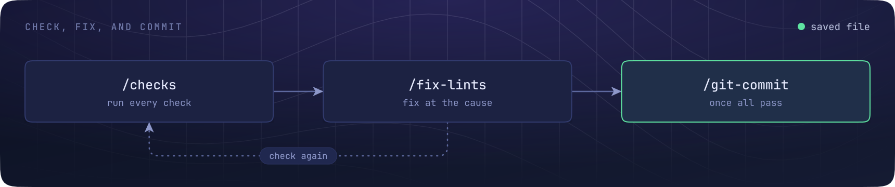
</p>

The agent runs the project's checks, fixes failures at the cause, and commits
the result once everything passes.

### Work through the backlog

```text
/goal /autopilot, using /git-worktree for each plan
```

<p align="center">
  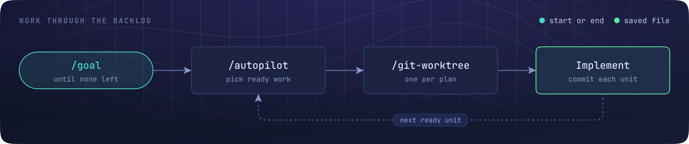
</p>

The agent picks up every ready task and plan in `.agenda/`, implements and
commits each one in its own worktree, and keeps going until nothing ready is
left.

### Clear the blockers first

```text
/unblock everything in .agenda, /decide + /recommended for the technical decisions,
then show /pending
```

<p align="center">
  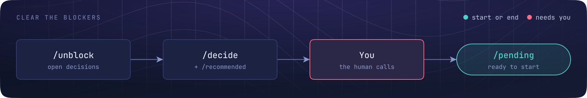
</p>

Open decisions get settled, the agent asks you only about the human ones, and
you end with a list of work that is ready to start.

### From roadmap to a running app

```text
/agenda-roadmap for offline support, and plan each feature I pick
```

```text
/goal /agenda-implement each plan it wrote with /fast-mode, then /run-app
so I can try it
```

<p align="center">
  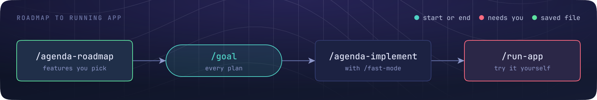
</p>

The agent researches the project and its field, proposes features, and records
the ones you pick with implementation plans. This takes two prompts because
choosing features needs you, and `/goal` must start its own message. The second
prompt builds every plan without pausing for slow test suites and starts the
app for you to try.

### Start a new project

```text
/wizard I want a CLI that syncs my dotfiles across machines. /research-web
how existing tools handle conflicts first
```

<p align="center">
  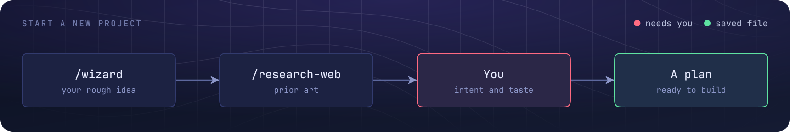
</p>

State your intent or a rough idea. The agent looks at prior art, asks about
whatever it can't settle itself, makes the technical calls, and turns the
result into a plan for setting the project up.

### Decide with criteria, not guesses

```text
/criteria should the sync cache live in memory or in SQLite? /options first,
then /recommended
```

<p align="center">
  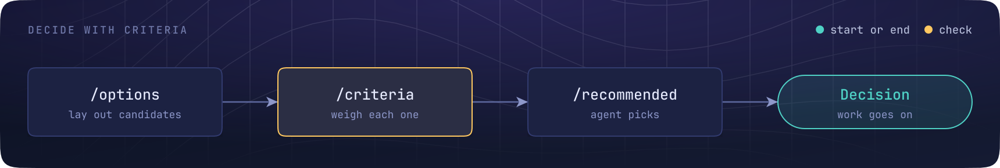
</p>

`/options` lays out the candidates, `/criteria` weighs them on usefulness,
soundness, consistency, and proportion instead of a gut call, and
`/recommended` lets the agent take its own pick and carry on. Use `/criteria`
often.

### Implement a plan

```text
/goal /agenda-implement .agenda/plans/12-[planned]-offline-sync.md /git-worktree
```

<p align="center">
  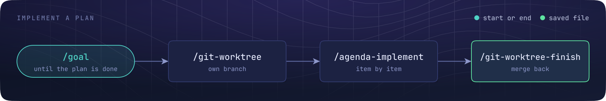
</p>

The agent carries the plan through to the end in its own worktree, so other
agents and your checkout stay untouched, and merges it back when done. Swap
`/git-worktree` for `/fast-mode` to skip heavy checks, builds, and long tests
and spend the time writing code. That suits landing a lot of work first, then
fixing whatever turns up in one sweep with `/checks /fix-lints`.

### Chase a bug to its source

```text
/debug why sync drops the last file on Linux, /root-cause once it's clear,
then /debug-cleanup and /git-commit
```

<p align="center">
  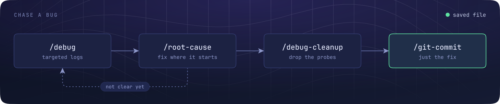
</p>

Targeted logging finds the cause, the fix lands where the bug starts, and the
probes come out before the commit.

### Review before you publish

```text
/review-bugs and /review-security on this branch, fix what's clear, then
/review-leaks /review-pii before I push
```

<p align="center">
  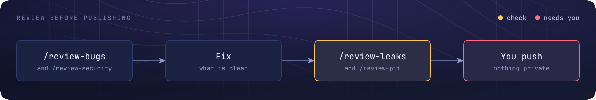
</p>

Several focused reviews run over the same change, clear issues get fixed, and
the last two make sure nothing private ships.
